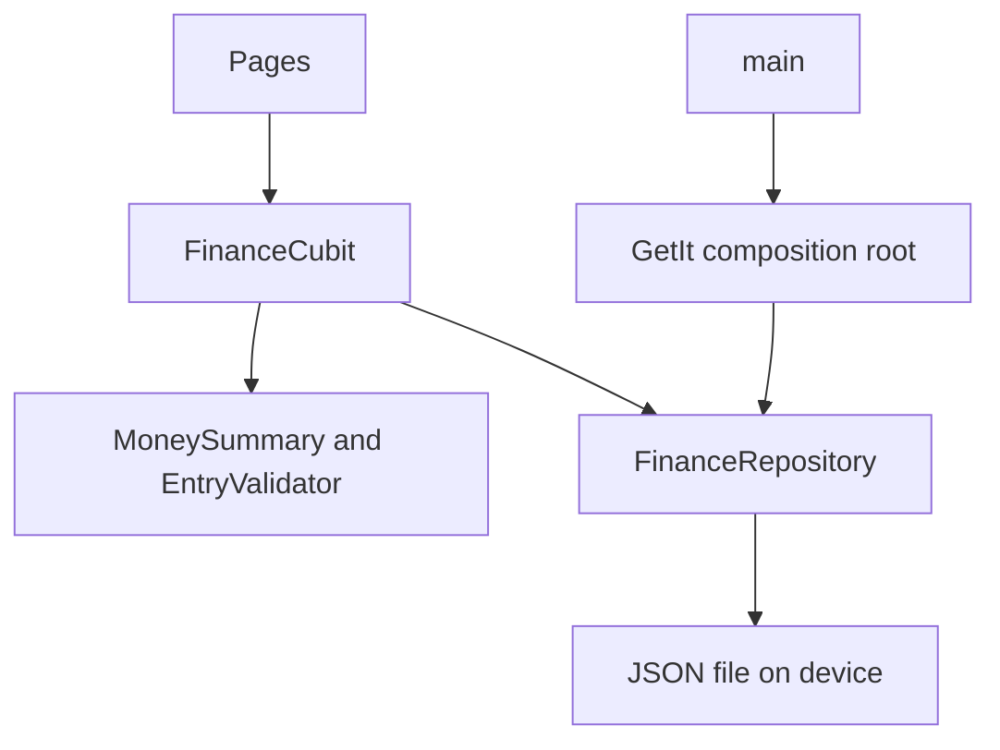

# FinFlow

FinFlow is a personal finance tracker for one device. It shows a cash balance, monthly income and expenses, category budgets, and a sample investment overview.

The ledger is sample data plus whatever you add locally. **No bank, broker, or market feed is connected.** Prices on the Investments tab are stored numbers, not live quotes. The app is not deployed to the App Store or Play Store.

## Problem

Interview discussions about finance apps often stay at the widget level. FinFlow is a small but complete ledger: typed models, a repository, a cubit, local persistence, and tests around the calculations that must not be wrong.

## Features

- Dashboard with all-time balance, monthly income, expenses, and what is left
- Transaction list with search, category filters, create, edit, and confirmed delete
- Monthly spending bar chart
- Category budgets with a progress bar and an editable limit
- Sample holdings with cost, last price, and unrealized gain
- Light and dark themes, saved on device
- Loading, empty, and error states
- Restore action that puts the original sample ledger back

## Screenshots

Screenshots have not been captured. The app was verified with `flutter analyze` and `flutter test` on Flutter 3.44.9. A device or desktop run is still required before adding images here.

## Architecture



Widgets read `FinanceCubit` through `BlocProvider`. They do not read the file. `MoneySummary` is a pure function, so income, expenses, and category totals can be tested without Flutter.

Amounts are stored as positive numbers. `MoneyDirection` says whether the amount is income or expense. Dates are stored as `yyyy-MM-dd` so a timezone does not move a transaction into another month.

GetIt is used only in `lib/injection.dart`, when the real app starts. Tests construct `FinFlowApp` with an in-memory repository and never touch GetIt.

## Folder structure

```text
lib/
  main.dart                 app entry, calls configureDependencies
  app.dart                  MaterialApp and providers
  injection.dart            GetIt composition root
  core/format               rupee formatting and month labels
  core/theme                light and dark ThemeData
  domain/                   models, summary, validation, repository contracts
  data/                     sample ledger, JSON files, in-memory fakes
  presentation/             cubits and pages
test/                       unit and widget tests
```

## Stack

| Choice | Why |
| --- | --- |
| Cubit | The screen state is load, ready, or failure plus a few filters. A full Bloc event class would not add clarity. |
| Repository | The UI can run on a memory fake in tests and a JSON file in the app. |
| JSON file | The ledger is small. A database plugin is unnecessary, and a temp file is easy to test. |
| GetIt | One composition root for the file repositories. Widgets still receive state from BlocProvider. |
| fl_chart | One bar chart for monthly category spend. |

## Setup

Requirements: Flutter 3.44.9 and Dart 3.12.2.

```bash
flutter pub get
flutter run
```

The first launch writes `finflow_ledger.json` and `finflow_preferences.json` under the app documents directory.

## Environment

No API keys. No `.env` file. Nothing in this project should be a secret.

`android/local.properties` is machine-local and is gitignored.

## Testing

Verified locally on 12 October 2026 with Flutter 3.44.9:

- `flutter analyze` — no issues
- `flutter test` — 13 tests passed

CI runs format, analyze, and test on Flutter 3.44.9. That workflow has not been observed on GitHub yet, because the repository has not been published.

```bash
dart format --output=none --set-exit-if-changed .
flutter analyze
flutter test
```

There is no coverage percentage in this README. Coverage was not measured.

## Known limitations

- Holdings cannot be edited. They are a fixed sample portfolio.
- There is no authentication, encryption, or cloud backup.
- Charts show one month of category totals, not a time series.
- A corrupt ledger file shows an error. Use Retry after fixing the file, or Restore sample data.
- The app has not been run on a phone or emulator in this snapshot, so layout was checked at 390×844 in a widget test only.

## Future improvements

- Edit holdings, or remove them until a real price source exists
- Export the JSON ledger
- Widget tests for the budget editor
- Run the app on a device and add screenshots

## Interview notes

See [INTERVIEW_GUIDE.md](INTERVIEW_GUIDE.md).

## License

[MIT](LICENSE) © 2026 Shubham Tomar

## Links

- Author: Shubham Tomar — shubhamtomarr68@gmail.com
- GitHub: https://github.com/shubhamtomarr68-hub/flutter-finflow
